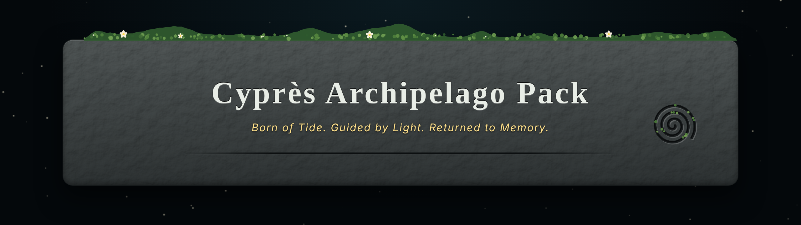

# Cyprès Archipelago Pack

### [Read our lore book](https://trashgremlinx.github.io/CAP-Fallowe/)

This is the lore book for my Wolvden pack, the Cyprès Archipelago Pack.

It is a small interactive page with five parts: a map of the islands, the pack's timeline, the Keepers of the Coil, Life's Threads, and Fennsael. Everything in it was written and made by me, and I add to it as the story grows.

Created by Fallowe. © 2026. All rights reserved. Please do not copy or reuse anything here without permission. See LICENSE for details.

Wolvden: https://www.wolvden.com/profile/145906
Discord: https://discord.gg/ZQDz8ANTUR
